# Weighted Survival Analysis Examples

## Overview

In this vignette of the `weightedsurv` package (Leon 2024) we illustrate
various weighted survival analyses with two breast cancer datasets
available in the base R `survival` library (Therneau 2023), both
comparing hormonal therapy with no hormonal therapy. The `gbsg` trial
(Schumacher et al. 1994) was randomized, whereas the `rotterdam` study
(Royston and Altman 2013) was observational; for the non-randomized
comparison the hazard ratio is estimated with and without
propensity-score weighting (Cole and Hernán 2004) in a restricted
Rotterdam population, and shown next to the hazard ratio of the GBSG
trial data, each with its confidence interval. The three values are
given in the section “Restricted population: postmenopausal women
without chemotherapy”.

## Survival Analysis and KM Plotting

Survival analysis functions allowing for time-dependent and
subject-specific (eg, propensity-scores) weighting.

Weighted estimation for: Cox model; Kaplan-Meier treatment survival
curves as well as treatment difference along with point-wise and
simultaneous confidence bands; and Restricted mean survival time (RMST,
Uno et al. (2014)) comparisons where RMST estimates are evaluated across
all potential truncation times (point-wise and simultaneous bands).

Summary: Weighted Survival Analysis Capabilities

- Weighted Kaplan-Meier and Log-Rank Analyses
  - The code provides functions to compute and plot weighted
    Kaplan-Meier survival curves for two groups (treatment coded 0/1),
    using subject-specific weights. Weighted log-rank statistics can be
    calculated using flexible, time-dependent weighting schemes (e.g.,
    Fleming-Harrington, Schemper, Xu & O’Quigley, Magirr-Burman, and
    custom schemes).
    [`KM_estimates()`](https://larry-leon.github.io/weightedsurv/reference/KM_estimates.md)
    computes survival probabilities from weighted risk sets and event
    counts,
    [`KM_diff()`](https://larry-leon.github.io/weightedsurv/reference/KM_diff.md)
    the difference of two curves, and
    [`wlr_cumulative()`](https://larry-leon.github.io/weightedsurv/reference/wlr_cumulative.md)
    and
    [`wlr_dhat_estimates()`](https://larry-leon.github.io/weightedsurv/reference/wlr_dhat_estimates.md)
    weighted log-rank statistics (all in
    `R/km_wlr_calculations_helpers.R`).
- Weighted Cox Proportional Hazards Models
  - The code supports fitting Cox models with time-dependent weights,
    including rho-gamma weights for weighted log-rank tests, with or
    without subject-specific weights.
    [`cox_rhogamma()`](https://larry-leon.github.io/weightedsurv/reference/cox_rhogamma.md)
    and
    [`cox_score_rhogamma()`](https://larry-leon.github.io/weightedsurv/reference/cox_score_rhogamma.md)
    (in `R/weightedCox.R`) implement weighted Cox regression, including
    score calculations, confidence intervals, and resampling for
    inference
    ([`cox_rhogamma_resample()`](https://larry-leon.github.io/weightedsurv/reference/cox_rhogamma_resample.md)).
    The estimate is the root of the weighted score equation
    ([`find_cox_root()`](https://larry-leon.github.io/weightedsurv/reference/find_cox_root.md)).
- Flexible Weighting Schemes
  - `R/weighted_helpers.R` provides a framework for defining,
    validating, and applying a variety of time-dependent weighting
    schemes
    ([`wt.rg.S()`](https://larry-leon.github.io/weightedsurv/reference/wt.rg.S.md),
    [`validate_scheme_params()`](https://larry-leon.github.io/weightedsurv/reference/validate_scheme_params.md),
    [`get_validated_weights()`](https://larry-leon.github.io/weightedsurv/reference/get_validated_weights.md)).
    [`get_weights()`](https://larry-leon.github.io/weightedsurv/reference/get_weights.md)
    and
    [`extract_and_calc_weights()`](https://larry-leon.github.io/weightedsurv/reference/extract_and_calc_weights.md)
    compute the weights of one or several schemes at each time point,
    supporting both standard and custom schemes. Visualization of weight
    functions over time is supported via
    [`plot_weight_schemes()`](https://larry-leon.github.io/weightedsurv/reference/plot_weight_schemes.md).
- Counting Process Data Preparation
  - The code can transform raw survival data into a counting process
    format, which is essential for weighted analyses.
    [`df_counting()`](https://larry-leon.github.io/weightedsurv/reference/df_counting.md)
    (in `R/df_counting.R`) and the helpers in `R/df_counting_helpers.R`
    ([`get_dfcounting()`](https://larry-leon.github.io/weightedsurv/reference/get_dfcounting.md),
    [`extract_group_data()`](https://larry-leon.github.io/weightedsurv/reference/extract_group_data.md),
    [`calculate_risk_event_counts()`](https://larry-leon.github.io/weightedsurv/reference/calculate_risk_event_counts.md))
    prepare risk sets, event counts, and weighted summaries for each
    group, supporting both unweighted and weighted analyses.
- Propensity-Score Weights
  - [`ps_weights()`](https://larry-leon.github.io/weightedsurv/reference/ps_weights.md)
    (in `R/ps_weights.R`) fits a logistic model for the treatment and
    returns inverse-probability or stabilized weights, together with
    what is needed to carry the estimation of the weights into standard
    errors, intervals, bands and tests
    (`weight_variance = "estimated"`).
- Weighted RMST (Restricted Mean Survival Time)
  - [`cumulative_rmst_bands()`](https://larry-leon.github.io/weightedsurv/reference/cumulative_rmst_bands.md)
    (in `R/rmst_calculations.R`) calculates cumulative RMST and
    confidence bands using resampling, with support for weights.
- Plotting and Visualization
  - Weighted survival curves, confidence intervals, and risk tables can
    be plotted with
    [`plot_weighted_km()`](https://larry-leon.github.io/weightedsurv/reference/plot_weighted_km.md),
    and survival differences with bands with
    [`plotKM.band_subgroups()`](https://larry-leon.github.io/weightedsurv/reference/plotKM.band_subgroups.md)
    (functions in `R/kmplotting_helpers.R` and
    `R/df_counting_helpers.R`). The plotting functions support the
    display of weighted KM curves, weighted risk tables, and annotation
    of statistical results.

### Analysis functions

#### df_counting

Prepares a comprehensive dataset for survival analysis using the
counting process approach. Computes risk sets, event counts,
Kaplan-Meier estimates, log-rank (Fleming-Harrington ($`\rho,\gamma`$)
weights) and Cox model results, and quantile estimates for two groups
(e.g., treatment and control), optionally handling (subject-specific
case) weights (such as inverse probability weights) and stratification.

Time-dependent weights for log-rank statistics are implemented via
*wt.rg.S* function: Supporting a variety of commonly used and custom
weighting schemes for weighted log-rank and related tests. The function
is flexible and can be used for Fleming-Harrington, Schemper, Xu &
O’Quigley (XO), Magirr-Burman (MB), custom time-based, and exponential
variants of Fleming-Harrington weights.

Subject-specific (case-weights) are also included in order to implement
propensity-score weighted analyses.

*Key Features:* - Calculates weights for use in weighted log-rank and
related survival tests. - Supports standard Fleming-Harrington weights
(`scheme = "fh"`). - Implements Schemper weights
(`scheme = "schemper"`), XO weights (`scheme = "XO"`), MB weights
(`scheme = "MB"`). - Allows for custom time-based weights
(`scheme = "custom_time"`). - Supports exponential variants of
Fleming-Harrington weights (`scheme = "fh_exp1"`, `scheme = "fh_exp2"`).

#### plot_weighted_km

Creates Kaplan-Meier survival plots for two groups (e.g., treatment
vs. control), allowing for the use of weights (such as inverse
probability weights) in the estimation. The function can display
survival curves, confidence intervals, risk tables, and optionally
subgroup curves or additional annotations.

#### KM_diff

KM_diff compares Kaplan-Meier survival curves between two groups
(typically treatment vs. control) using time-to-event data. It
calculates survival estimates, their differences, and provides both
pointwise and simultaneous confidence intervals. The function can also
perform resampling to construct simultaneous confidence bands.

Allows for arbitrary weights (non-negative) to implement (for example)
propensity-score adjustment (IPW).

#### plotKM.band_subgroups

Plots the difference (via KM_diff calculations) in Kaplan-Meier survival
curves between two groups (e.g., treatment vs. control), optionally
including simultaneous confidence bands and subgroup curves. The
function also displays risk tables for the overall population and
specified subgroups.

#### wlr_dhat_estimates

Computes the weighted log-rank test statistic, its variance, the
difference in survival between two groups at a specified time point
(`tzero`), the variance of this difference, their covariance, and
correlation. It supports flexible time-dependent weighting schemes via
the `wt.rg.S` function.

#### cumulative_rmst_bands

The cumulative_rmst_bands function calculates and plots cumulative
Restricted Mean Survival Time (RMST) estimates and their confidence
bands for survival curves, typically comparing two groups (e.g.,
treatment vs. control).

Key Features

- Computes cumulative RMST over time for each group.

- Uses multiplier (martingale) resampling to estimate confidence bands
  for the RMST curves.

- Supports weighted analyses (optional).

- Plots the RMST curves and their confidence intervals along with
  simultaneous bands.

``` r

oldpar <- par(no.readonly = TRUE)
library(survival)
# To install weightedsurv: the released version from CRAN
# install.packages("weightedsurv")
# or the development version from GitHub
# devtools::install_github("larry-leon/weightedsurv")
library(weightedsurv)
if (has[["dplyr"]]) library(dplyr)
# formatting of the numbers quoted in the text
fmt <- function(x, digits = 2) formatC(x, format = "f", digits = digits)
```

## GBSG data analysis example

—- Data Preparation —- Prepare GBSG data

``` r

library(survival)
df_gbsg <- gbsg
df_gbsg$tte <- df_gbsg$rfstime / 30.4375
df_gbsg$event <- df_gbsg$status
df_gbsg$treat <- df_gbsg$hormon
df_gbsg$grade3 <- ifelse(df_gbsg$grade == "3", 1, 0)


# Note that these are default names
# For alternative names, for example if the 
# time-to-event outcome (tte) is time_months
# then tte.name <- "time_months"
tte.name <- "tte"
event.name <- "event"
treat.name <- "treat"
arms <- c("treat", "control")
```

—- Main Analyses —-

GBSG - ITT Analysis

``` r

# Returns standard log-rank (FH(0,0) via scheme="fh" rho,gamma = 0 in scheme_params)

dfcount_gbsg <- df_counting(df=df_gbsg, tte.name = tte.name, event.name = event.name, treat.name = treat.name, arms = arms, 
by.risk = 12, scheme = "fh", scheme_params = list(rho = 0, gamma =0), lr.digits = 4, cox.digits =3)

# test default names
#test <- df_counting(df=df_gbsg, by.risk = 12, scheme = "fh", scheme_params = list(rho = 0, gamma =0), lr.digits = 4, cox.digits =3)
```

``` r

# MB weighting
#test <- df_counting(df=df_gbsg, tte.name=tte.name, event.name=event.name, treat.name=treat.name, arms=arms, scheme = "MB", scheme_params = list(mb_tstar = 12))
# 0/1 weighting (0 for time <= t.tau, 1 for time > t.tau)
#test <- df_counting(df=df_gbsg, tte.name=tte.name, event.name=event.name, treat.name=treat.name, arms=arms, scheme = "custom_time", scheme_params = list(t.tau = 6, w0.tau = 0, w1.tau =1))
```

### Show some weight functions

``` r

g <- plot_weight_schemes(dfcount_gbsg)
print(g)
```

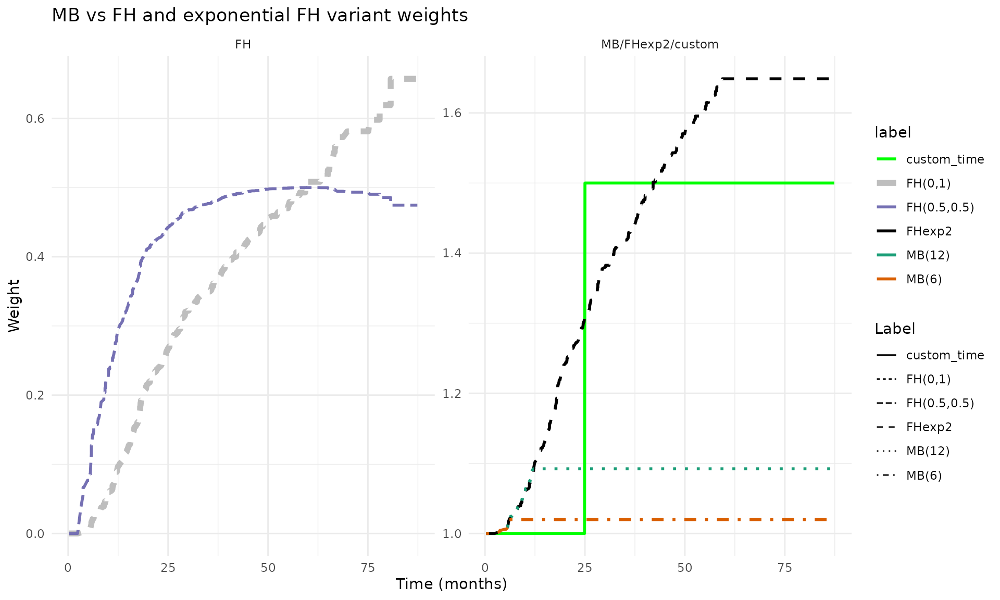

—- Plotting —- \## GBSG KM plots

``` r

par(mfrow=c(1,2))
# Mine
# Set ymax a little above 1.0 to allow for logrank placement in topleft
# topleft is default; xmed.fraction = 0.65 positions the display of the median estimates below the HR estimates ("topright" legend [default])
# For details, please see summary of xmed.fraction in the Appendix below.

plot_weighted_km(dfcount=dfcount_gbsg, conf.int=FALSE, show.logrank = TRUE, 
                 put.legend.lr = "topleft", ymax = 1.05, xmed.fraction = 0.65)
title(main="GBSG (trial) data un-weighted")


# Compare with survfit
plot_km(df=df_gbsg, tte.name=tte.name, event.name=event.name, treat.name=treat.name)
title(main="GBSG (trial) data un-weighted
      via survfit")
```

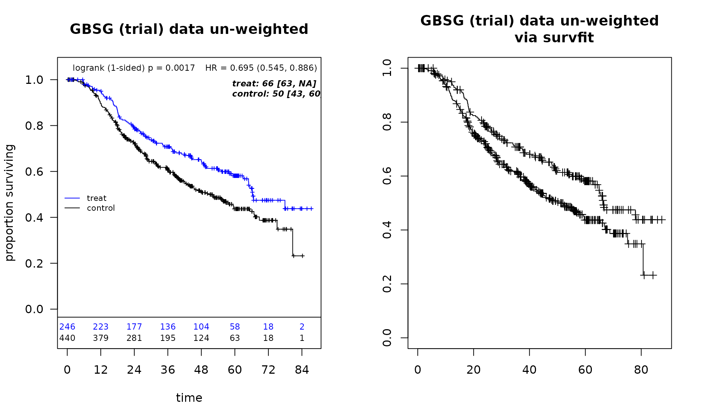

Include 95% CIs

``` r

plot_weighted_km(dfcount=dfcount_gbsg, conf.int=TRUE, show.logrank = TRUE, ymax = 1.05)
title(main="GBSG (trial) data un-weighted")
```

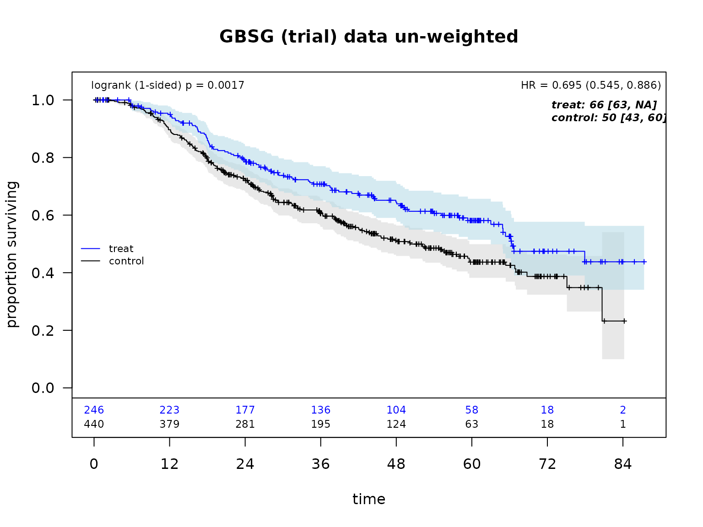

## Rotterdam observational data analysis with weighting

—- Propensity Score Weighting (Rotterdam) —-

Prepare Rotterdam data

``` r

gbsg_validate <- within(rotterdam, {
  rfstime <- ifelse(recur == 1, rtime, dtime)
  t_months <- rfstime / 30.4375
  time_months <- t_months
  status <- pmax(recur, death)
  ignore <- (recur == 0 & death == 1 & rtime < dtime)
  status2 <- ifelse(recur == 1 | ignore, recur, death)
  rfstime2 <- ifelse(recur == 1 | ignore, rtime, dtime)
  time_months2 <- rfstime2 / 30.4375
  grade3 <- ifelse(grade == "3", 1, 0)
  treat <- hormon
  event <- status2
  tte <- time_months
  id <- as.numeric(1:nrow(rotterdam))
  SG0 <- ifelse(er <= 0, 0, 1)
})
```

Node positive only to correspond to GBSG population. The node-positive
data are kept as `df_rotterdam_np`; the cross-trial comparison further
below uses them.

``` r

df_rotterdam_np <- subset(gbsg_validate, nodes > 0)
```

Time and event definition. Every Rotterdam analysis in this vignette
uses the time `tte`, which is `rfstime` in months (the time of
recurrence when there was one, otherwise the time of death or last
follow-up), and the event indicator `event`, which is `status2`: a
recurrence, or a death without recurrence, except that a death recorded
after the end of the recurrence follow-up (`rtime < dtime`) is not
counted as an event. Among the node-positive women `status2` differs
from `status = pmax(recur, death)` in 21 of 1546 rows.

Baseline demographics table (all node-positive women). This table needs
the dplyr package.

``` r

library(dplyr)
rotterdam2 <- df_rotterdam_np %>%
  mutate(
    meno = factor(meno, levels = c(0, 1), labels = c("Pre", "Post")),
    grade3 = factor(grade3, levels = c(0, 1), labels = c("Not Grade 3", "Grade 3")),
    chemo = factor(chemo, levels = c(0, 1), labels = c("No", "Yes")),
    er_negative = factor(ifelse(er == 0, 1, 0), labels = c("ER negative","ER positive"))
  )


baseline_table <- create_baseline_table(
  data = rotterdam2,
  treat_var = "treat",
  vars_continuous = c("age", "pgr", "er", "nodes"),
  vars_categorical = c("size","meno","chemo","er_negative"),
  show_pvalue = TRUE,
  show_smd = TRUE
)
```

``` r

baseline_table
```

| Baseline Characteristics by Treatment Arm |  |  |  |  |  |
|----|----|----|----|----|----|
| Characteristic |  | Control (n=1207) | Treatment (n=339) | P-value¹ | SMD² |
| age | Mean (SD) | 54.1 (13.2) | 62.5 (9.9) | \<0.001 | 0.67 |
| pgr | Mean (SD) | 169.7 (320.6) | 108.2 (200.3) | \<0.001 | 0.21 |
| er | Mean (SD) | 160.7 (266.0) | 180.6 (271.7) | 0.232 | 0.07 |
| nodes | Mean (SD) | 5.1 (5.0) | 5.7 (4.6) | 0.030 | 0.13 |
| size |  |  |  | 0.581 | 0.03 |
|  | \<=20 | 397 (32.9%) | 104 (30.7%) |  |  |
|  | 20-50 | 611 (50.6%) | 172 (50.7%) |  |  |
|  | \>50 | 199 (16.5%) | 63 (18.6%) |  |  |
| meno |  |  |  | \<0.001 | 0.31 |
|  | Pre | 587 (48.6%) | 41 (12.1%) |  |  |
|  | Post | 620 (51.4%) | 298 (87.9%) |  |  |
| chemo |  |  |  | \<0.001 | 0.32 |
|  | No | 655 (54.3%) | 311 (91.7%) |  |  |
|  | Yes | 552 (45.7%) | 28 (8.3%) |  |  |
| er_negative |  |  |  | 1.000 | 0.00 |
|  | ER negative | 1058 (87.7%) | 297 (87.6%) |  |  |
|  | ER positive | 149 (12.3%) | 42 (12.4%) |  |  |
| ¹ P-values: t-test for continuous, chi-square/Fisher's exact for categorical/binary variables |  |  |  |  |  |
| ² SMD = Standardized mean difference |  |  |  |  |  |

### Effective sample size with all node-positive women

Propensity score model for all node-positive women.
[`ps_weights()`](https://larry-leon.github.io/weightedsurv/reference/ps_weights.md)
fits the logistic model and returns the weights (here stabilized
weights; the default is `type = "ipw"`).

``` r

pw_np <- ps_weights(treat ~ age + meno + size + grade3 + nodes + pgr + chemo + er,
                    data = df_rotterdam_np, type = "stabilized")
df_rotterdam_np$sw.weights <- pw_np$weights

dfcount_np_wtd <- get_dfcounting(df=df_rotterdam_np, tte.name=tte.name, event.name=event.name, treat.name=treat.name, arms=arms, by.risk=24, 
                                  weight.name="sw.weights")
knitr::kable(dfcount_np_wtd$ess, digits = c(0, 0, 1, 3))
```

| group   |    n |    ess | ratio |
|:--------|-----:|-------:|------:|
| treat   |  339 |  105.2 | 0.310 |
| control | 1207 | 1162.9 | 0.964 |

`df_counting()$ess` gives, by arm, the number of subjects `n`, the
effective sample size `ess` $`= (\sum_i w_i)^2 / \sum_i w_i^2`$ and
their ratio: a ratio near 1 means that the weights are spread evenly
over the arm, a low ratio that a few subjects carry most of the weight.
Here the ratio of the treated arm is 0.31 (the 339 treated women count
for about 105) and the largest weight is 12.9. In these data hormonal
therapy went mostly to postmenopausal women who had no chemotherapy (291
of the 339 treated women), so the few treated women who were
premenopausal or had chemotherapy receive large weights. For this reason
the weighted example is restricted to postmenopausal women without
chemotherapy.

### Restricted population: postmenopausal women without chemotherapy

Propensity score model on the rows analysed (`meno` and `chemo` are
constant in this population and leave the model). The object returned by
[`ps_weights()`](https://larry-leon.github.io/weightedsurv/reference/ps_weights.md)
is kept: it is passed below as `weight_model`, so that standard errors,
intervals, bands and tests account for the estimation of the weights
(`weight_variance = "estimated"`).

``` r

df_rotterdam <- subset(df_rotterdam_np, meno == 1 & chemo == 0)

pw <- ps_weights(treat ~ age + size + grade3 + nodes + pgr + er,
                 data = df_rotterdam, type = "stabilized")
pw
```

    ## Propensity-score weights (stabilized): n = 829, 8 coefficients in the logistic model
    ##        arm   n weight min weight max   ess ess / n
    ##  treat = 1 291     0.6809      2.709 270.7  0.9301
    ##  treat = 0 538     0.6621      1.329 529.3  0.9837

``` r

df_rotterdam$sw.weights <- pw$weights
```

The restricted population has 829 women: 538 without and 291 with
hormonal therapy.

Standardized differences (treated minus control, in units of the pooled
unweighted standard deviation) of the model’s covariates, before and
after weighting:

``` r

std_diff <- function(x, a, w) {
  (weighted.mean(x[a == 1], w[a == 1]) - weighted.mean(x[a == 0], w[a == 0])) /
    sqrt((var(x[a == 1]) + var(x[a == 0])) / 2)
}
X_ps <- model.matrix(~ age + size + grade3 + nodes + pgr + er, data = df_rotterdam)[, -1]
balance <- data.frame(
  covariate = colnames(X_ps),
  unweighted = apply(X_ps, 2, std_diff, a = df_rotterdam$treat, w = rep(1, nrow(df_rotterdam))),
  weighted = apply(X_ps, 2, std_diff, a = df_rotterdam$treat, w = df_rotterdam$sw.weights),
  row.names = NULL
)
knitr::kable(balance, digits = 3)
```

| covariate | unweighted | weighted |
|:----------|-----------:|---------:|
| age       |     -0.131 |   -0.001 |
| size20-50 |     -0.117 |   -0.009 |
| size\>50  |      0.032 |   -0.004 |
| grade3    |      0.250 |    0.003 |
| nodes     |      0.067 |    0.001 |
| pgr       |     -0.259 |   -0.053 |
| er        |     -0.137 |    0.007 |

The largest absolute standardized difference is 0.26 before weighting
and 0.05 after.

Un-weighted and weighted analyses

``` r

dfcount_rotterdam_unwtd <- get_dfcounting(df=df_rotterdam, tte.name=tte.name, event.name=event.name, treat.name=treat.name, arms=arms, by.risk=24)

dfcount_rotterdam_wtd <- get_dfcounting(df=df_rotterdam, tte.name=tte.name, event.name=event.name, treat.name=treat.name, arms=arms, by.risk=24, 
                                  weight.name="sw.weights", weight_variance = "estimated", weight_model = pw)

knitr::kable(dfcount_rotterdam_wtd$ess, digits = c(0, 0, 1, 3))
```

| group   |   n |   ess | ratio |
|:--------|----:|------:|------:|
| treat   | 291 | 270.7 | 0.930 |
| control | 538 | 529.3 | 0.984 |

Both ratios are close to 1 (0.93 treated, 0.98 control) and the largest
weight is 2.7: the weights are spread evenly within each arm.

The weighted hazard ratio is 0.66 (0.56, 0.78), the unweighted one 0.72
(0.60, 0.86). For context, in the GBSG trial data analysed above it is
0.69 (0.54, 0.89).

—- Plotting Weighted vs Unweighted —-

``` r

par(mfrow=c(1,2))
plot_weighted_km(dfcount=dfcount_rotterdam_unwtd, xmed.fraction = 0.65)
title(main="Rotterdam un-weighted K-M curves")
plot_weighted_km(dfcount=dfcount_rotterdam_wtd, xmed.fraction = 0.65)
title(main="Rotterdam weighted K-M curves")
```

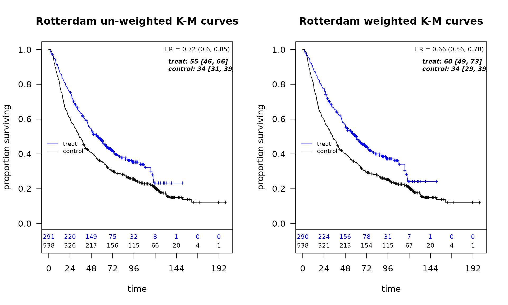 \##
Compare with GBSG trial data

``` r

par(mfrow=c(1,2))
plot_weighted_km(dfcount=dfcount_gbsg, conf.int = TRUE, xmed.fraction = 0.65, show.logrank = TRUE, ymax = 1.05)
title(main="GBSG (trial) data un-weighted K-M curves")
plot_weighted_km(dfcount=dfcount_rotterdam_wtd, conf.int = TRUE, xmed.fraction = 0.65, show.logrank = TRUE, ymax = 1.05)
title(main="Rotterdam weighted K-M curves")
```

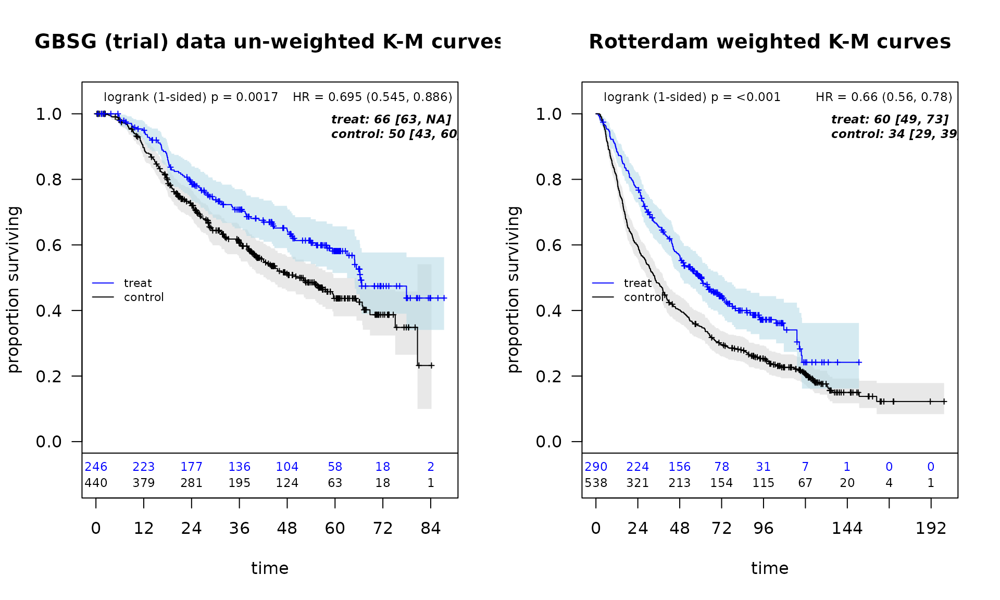

#### Simultaneous bands and point-wise CIs

The first graph displays the first 20 resampled approximations to the
centered survival difference

$`\Delta(t) = (\widehat{S_1} - \widehat{S_0})(t) - (S_{1} - S_{0})(t),`$
each divided by the standard error of the difference at $`t`$ (the
curves `Zdhat_star` of
[`KM_diff()`](https://larry-leon.github.io/weightedsurv/reference/KM_diff.md)).
The simultaneous band is
$`(\widehat{S_1} - \widehat{S_0})(t) \pm c_{\alpha}\, \widehat{se}(t)`$,
where $`c_{\alpha}`$ is the $`1-\alpha`$ quantile, over the `draws.band`
resampled curves, of the largest absolute standardized value. The
supremum, and so the band, is over the whole time range of the call:
every time point up to the smaller of the two arms’ last event times (or
up to `tau_add`, when that is later). No quantile range is trimmed
(`qtau` acts only with `modify_tau = TRUE`, which is not used here).

With `weight_variance = "estimated"` and `weight_model = pw` the
pointwise limits and the band account for the estimation of the weights.

—- Simultaneous CI bands —-

``` r

par(mfrow=c(1,2))
 
 temp <- plotKM.band_subgroups(
    df=df_rotterdam,
    xlabel="Months", ylabel="Survival difference",
    yseq_length=5, cex_Yaxis=0.7, risk_cex=0.7,
    tau_add=42, by.risk = 12, risk_delta=0.075, risk.pad=0.03, ymax.pad = 0.125,
    tte.name = tte.name, treat.name = treat.name, event.name = event.name, weight.name = "sw.weights",
    draws.band = 1000, show_resamples = TRUE,
    weight_variance = "estimated", weight_model = pw
  )
  legend("topleft", c("Difference estimate", "95% pointwise CIs"),
         lwd=c(2,1), col=c("black"), lty=c(1,2), bty="n", cex=0.7)
  title(main="Rotterdam data
        propensity score weighted")
```

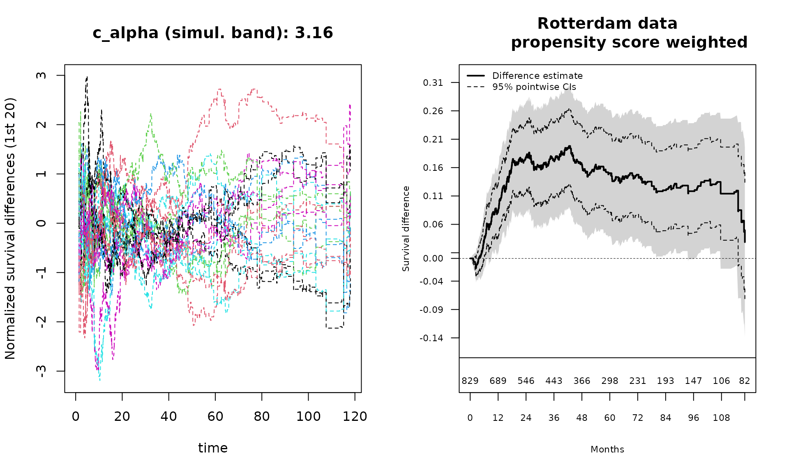

## Compare Rotterdam observational data with propensity-score weighting and GBSG randomized data

—- Simultaneous CI bands —-

``` r

par(mfrow=c(2,2))
 
 temp <- plotKM.band_subgroups(
    df=df_rotterdam,
    xlabel="Months", ylabel="Survival difference",
    yseq_length=5, cex_Yaxis=0.7, risk_cex=0.7,
    tau_add=42, by.risk = 12, risk_delta=0.075, risk.pad=0.03, ymax.pad = 0.125,
    tte.name = tte.name, treat.name = treat.name, event.name = event.name, weight.name = "sw.weights",
    draws.band = 1000, show_resamples = FALSE,
    weight_variance = "estimated", weight_model = pw
  )
  legend("topleft", c("Difference estimate", "95% pointwise CIs"),
         lwd=c(2,1), col=c("black"), lty=c(1,2), bty="n", cex=0.7)
  title(main="Rotterdam data
        propensity score weighted")

get_bands <- cumulative_rmst_bands(df = df_rotterdam, fit = temp$fit_itt, 
tte.name = tte.name, event.name = event.name, treat.name = treat.name , weight.name = "sw.weights", 
draws_sb = 1000, xlab="months", rmst_max_cex = 0.7,
weight_variance = "estimated", weight_model = pw)

legend("topleft", c("Cumulative RMST estimate", "95% pointwise CIs"),
         lwd=c(2,1), col=c("black"), lty=c(1,2), bty="n", cex=0.7)

# kept for the comparison of the two weight_variance options below
band_rotterdam <- temp
rmst_rotterdam <- get_bands
  


temp <- plotKM.band_subgroups(
    df=df_gbsg, 
    Maxtau = NULL,
    xlabel="Months", ylabel="Survival difference",
    yseq_length=5, cex_Yaxis=0.7, risk_cex=0.7,
    by.risk = 6, risk_delta=0.075, risk.pad=0.03,
    tte.name = tte.name, treat.name = treat.name, event.name = event.name, 
    draws.band = 1000, show_resamples = FALSE
  )
  legend("topleft", c("Difference estimate", "95% pointwise CIs"),
         lwd=c(2,1), col=c("black"), lty=c(1,2), bty="n", cex=0.75)
  title(main="GBSG data")

  
get_bands <- cumulative_rmst_bands(df = df_gbsg, fit = temp$fit_itt, 
tte.name = tte.name, event.name = event.name, treat.name = treat.name, 
draws_sb = 1000, xlab="months", rmst_max_cex = 0.75)
  legend("topleft", c("Cumulative RMST estimate", "95% pointwise CIs"),
         lwd=c(2,1), col=c("black"), lty=c(1,2), bty="n", cex=0.75)
```

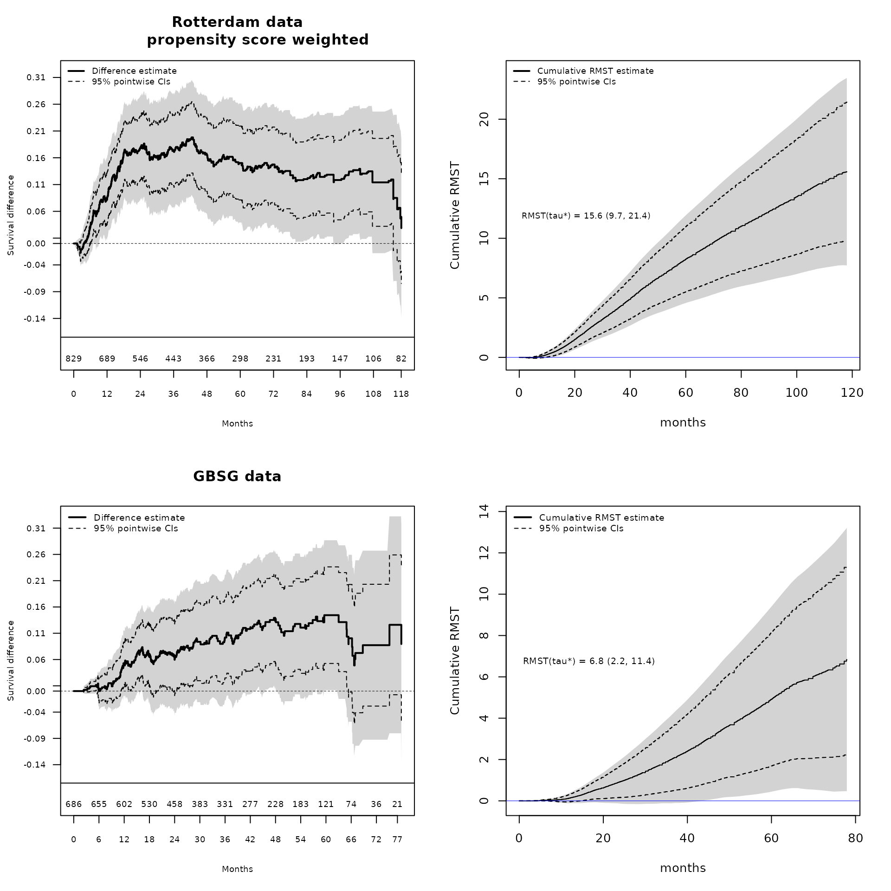

### Weights treated as known or as estimated

The Rotterdam analyses above use `weight_variance = "estimated"`: the
weights come from a logistic propensity model fitted on the rows
analysed, and its estimation is carried into the log-rank test, the
hazard-ratio interval, the survival difference and the RMST. The
default, `weight_variance = "known"`, treats the weights as fixed
numbers. No estimate differs between the two options; standard errors,
intervals, bands and tests do. The same analyses under both options
(FH(0,0) weights; RMST difference at the last time point of the band
plot):

``` r

dfcount_rotterdam_known <- get_dfcounting(df=df_rotterdam, tte.name=tte.name, event.name=event.name, treat.name=treat.name, arms=arms, by.risk=24, 
                                  weight.name="sw.weights")

# survival difference and RMST with the weights treated as known, on the time grid of the band plot
fit_known <- KM_diff(df = df_rotterdam, tte.name = tte.name, event.name = event.name, treat.name = treat.name,
                     weight.name = "sw.weights", at_points = band_rotterdam$fit_itt$at_points, draws.band = 1000)
rmst_known <- cumulative_rmst_bands(df = df_rotterdam, fit = fit_known,
                                    tte.name = tte.name, event.name = event.name, treat.name = treat.name,
                                    weight.name = "sw.weights", draws_sb = 1000, plot = FALSE)

option_row <- function(dfcount, rmst) {
  cox <- cox_rhogamma(dfcount = dfcount, scheme = "fh", scheme_params = list(rho = 0, gamma = 0))
  ci <- cox$hr_ci_asy
  r <- rmst$rmst_maxtau_ci
  data.frame(
    weights = cox$weight_variance,
    z = fmt(dfcount$z.score, 2),
    HR = paste0(fmt(ci$hr, 2), " (", fmt(ci$lower, 2), ", ", fmt(ci$upper, 2), ")"),
    RMST = paste0(fmt(r[1], 1), " (", fmt(r[2], 1), ", ", fmt(r[3], 1), ")")
  )
}
known_vs_estimated <- rbind(option_row(dfcount_rotterdam_known, rmst_known),
                            option_row(dfcount_rotterdam_wtd, rmst_rotterdam))
knitr::kable(known_vs_estimated, align = "lrrr",
             col.names = c("Weights treated as", "Log-rank z", "Hazard ratio (95% CI)",
                           paste0("RMST difference at ", fmt(max(rmst_rotterdam$at_points), 1), " months (95% CI)")))
```

| Weights treated as | Log-rank z | Hazard ratio (95% CI) | RMST difference at 118.0 months (95% CI) |
|:---|---:|---:|---:|
| known | 4.45 | 0.66 (0.56, 0.80) | 15.6 (9.2, 22.0) |
| estimated | 4.87 | 0.66 (0.56, 0.78) | 15.6 (9.7, 21.4) |

Reading: the hazard ratio and the RMST difference are the same in the
two rows. With the weights treated as estimated the log-rank z is larger
and both intervals are shorter than with the weights treated as known.

Neither option is the better one in general. In the evaluation of this
version of the package (section “Simulation results by time” of the
article `estimated_weights_methodology`), with evenly spread weights
`"estimated"` was close to nominal and `"known"` was conservative; with
concentrated weights both fell short of nominal, at the earliest or the
latest months depending on the design (Table 1 and Figure 1 of that
section), and the shortfall came from the weights. The effective sample
size table shows how the weights are spread. `"known"` is kept below for
the FH(0,1) and the other time-weighted Cox analyses and for the
cross-trial example. The derivation and the statistical properties of
this option are in the article `estimated_weights_methodology`
(“Estimated propensity-score weights: statistical details and
properties”).

## Compare GBSG experimental to Rotterdam control

This cross-trial comparison (GBSG treated against Rotterdam
node-positive control) is kept as a hard case for weighting: see the
effective sample size table and the caveats below. The controls are all
node-positive Rotterdam women without hormonal therapy
(`df_rotterdam_np`, not the restricted population above), and the
weights are treated as known (`weight_variance = "known"`, the default).
The code of this section uses the dplyr package: its tables, figures and
numbers need that package.

Propensity score model

``` r

df_gbsg_treat <- subset(df_gbsg, treat == 1)
df_rotterdam_control <- subset(df_rotterdam_np, treat == 0)

df_gbsg_treat <- df_gbsg_treat %>%
  mutate(
    size = ifelse(size <= 20, "<=20", ifelse(size > 20 & size <=50, "20-50", ">50")),
  )


# note: GBSG does not have "chemo" variable

df_gbsg_treat <- df_gbsg_treat[,c("tte","event","treat","age","meno","size","grade3","nodes","pgr","er")]
df_rotterdam_control <- df_rotterdam_control[,c("tte","event","treat","age","meno","size","grade3","nodes","pgr","er")]

# cross-trial-comparison (CTC)

df_CTC <- rbind(df_gbsg_treat, df_rotterdam_control)

fit.ps <- glm(treat ~ age + meno + size + grade3 + nodes + pgr + er, data = df_CTC, family="binomial")
pihat <- fit.ps$fitted
pihat.null <- glm(treat ~ 1, family="binomial", data = df_CTC)$fitted
wt.1 <- pihat.null / pihat
wt.0 <- (1 - pihat.null) / (1 - pihat)

df_CTC$sw.weights <- ifelse(df_CTC$treat == 1, wt.1, wt.0)
```

Baseline demographics table

``` r

df_CTC$er_negative <- ifelse(df_CTC$er == 0, 1, 0) 

baseline_table <- create_baseline_table(
  data = df_CTC,
  treat_var = "treat",
  vars_continuous = c("age", "pgr", "er", "nodes"),
  vars_categorical = c("size","meno","er_negative"),
  show_pvalue = TRUE,
  show_smd = TRUE
)
```

``` r

baseline_table
```

| Baseline Characteristics by Treatment Arm |  |  |  |  |  |
|----|----|----|----|----|----|
| Characteristic |  | Control (n=1207) | Treatment (n=246) | P-value¹ | SMD² |
| age | Mean (SD) | 54.1 (13.2) | 56.6 (9.4) | \<0.001 | 0.20 |
| pgr | Mean (SD) | 169.7 (320.6) | 124.3 (249.7) | 0.014 | 0.15 |
| er | Mean (SD) | 160.7 (266.0) | 125.8 (191.1) | 0.016 | 0.14 |
| nodes | Mean (SD) | 5.1 (5.0) | 5.1 (5.3) | 0.923 | 0.01 |
| size |  |  |  | \<0.001 | 0.14 |
|  | \<=20 | 397 (32.9%) | 67 (27.2%) |  |  |
|  | \>50 | 199 (16.5%) | 14 (5.7%) |  |  |
|  | 20-50 | 611 (50.6%) | 165 (67.1%) |  |  |
| meno |  |  |  | \<0.001 | 0.18 |
|  | 0 | 587 (48.6%) | 59 (24.0%) |  |  |
|  | 1 | 620 (51.4%) | 187 (76.0%) |  |  |
| er_negative |  |  |  | 0.501 | 0.02 |
|  | 0 | 1058 (87.7%) | 220 (89.4%) |  |  |
|  | 1 | 149 (12.3%) | 26 (10.6%) |  |  |
| ¹ P-values: t-test for continuous, chi-square/Fisher's exact for categorical/binary variables |  |  |  |  |  |
| ² SMD = Standardized mean difference |  |  |  |  |  |

``` r

dfcount_CTC_unwtd <- get_dfcounting(df = df_CTC, tte.name=tte.name, event.name=event.name, treat.name=treat.name, arms=arms, by.risk=24)

dfcount_CTC_wtd <- get_dfcounting(df=df_CTC, tte.name=tte.name, event.name=event.name, treat.name=treat.name, arms=arms, by.risk=24, 
                                  weight.name="sw.weights", weight_variance = "known")

knitr::kable(dfcount_CTC_wtd$ess, digits = c(0, 0, 1, 3))
```

| group   |    n |    ess | ratio |
|:--------|-----:|-------:|------:|
| treat   |  246 |   73.0 | 0.297 |
| control | 1207 | 1098.8 | 0.910 |

The effective sample size of the treated arm is 73 of 246 (ratio 0.30),
and the largest weight is 13.0: a few GBSG patients carry most of the
weight of the treated arm.

Caveats. Weighting does not make these two studies comparable.

- Grade 3 tumours are 20% of the GBSG treated arm and 74% of the
  Rotterdam control arm, and grade is recorded differently in the two
  studies (values 1/2/3 in `gbsg`, 2/3 in `rotterdam`).
- 76% of the GBSG treated arm are postmenopausal, against 51% of the
  Rotterdam control arm.
- The effective sample size ratio of the treated arm is 0.30; with
  weights this concentrated, standard errors, intervals and tests can be
  too optimistic.
- Few treated patients are at risk late: 104 at 48 months, 58 at 60
  months and 18 at 72 months (of 246).

For these reasons the results below are read up to 60 months.

``` r

par(mfrow=c(2,2))
plot_weighted_km(dfcount=dfcount_gbsg, conf.int = TRUE, xmed.fraction = 0.65, show.logrank = TRUE, ymax = 1.2, show.med = FALSE)
title(main="GBSG (trial) data un-weighted K-M curves")
plot_weighted_km(dfcount=dfcount_CTC_wtd, conf.int = TRUE, xmed.fraction = 0.65, show.logrank = TRUE, ymax = 1.2, show.med = FALSE)
title(main="CTC weighted K-M curves")
plot_weighted_km(dfcount=dfcount_CTC_unwtd, conf.int = TRUE, xmed.fraction = 0.65, show.logrank = TRUE, ymax = 1.2, show.med = FALSE)
title(main="CTC un-weighted K-M curves")
```

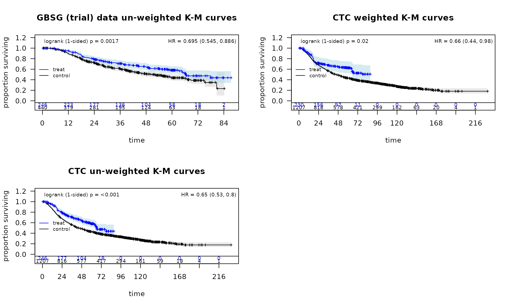

### Cumulative weighted log-rank statistics

The log-rank statistic only accumulates at times when both groups have
subjects at risk.

The figure below shows the cumulative log-rank z-statistic as a function
of time. The curve is drawn from the time at which each arm has had 10
events (9.4 months; before that the statistic rests on very few events).
The dashed vertical line is at 60 months, where z = 2.30; the solid
horizontal line is at 1.96. The follow-up of the GBSG treated arm ends
at 87.4 months; from then on no treated patient is at risk and the curve
is constant, at z = 2.11, the value of the test on all the data. Between
60 months and the end of the treated follow-up the curve rests on the
few treated patients still at risk (see the caveats above).

``` r

par(mfrow=c(1,1))
temp <- wlr_cumulative(dfcount_CTC_wtd, scheme_params = list(rho = 0, gamma = 0), scheme = "fh", return_cumulative = TRUE)
shown <- temp$time >= t_start
# y-axis: the range of the plotted curve and of the reference line
ylim <- range(c(temp$z.score[shown], qnorm(0.975)))
ylim <- ylim + c(-0.05, 0.05) * diff(ylim)
plot(temp$time[shown], temp$z.score[shown], xlab="time", ylab="cumulative log-rank Z", type="s", ylim=ylim)
abline(h = qnorm(0.975), lwd=2, col="red")
abline(v = horizon, lwd=1, col="blue", lty=2)
```


Cumulative weighted log-rank z-statistic (cross-trial comparison), drawn
from the 10th event in each arm (9.4 months). Dashed line: 60 months.

### Reading the cross-trial comparison at a common horizon

The two arms differ strongly in follow-up: the GBSG treated arm ends at
87.4 months, the Rotterdam control arm at 230.9 months. The
survival-difference and cumulative RMST plots below run to the smaller
of the two arms’ last event times (77.9 months for the cross-trial
data), as called; for the reasons given above we read them at 60 months.
The hazard ratio and the log-rank test are also computed with follow-up
cut at 60 months (events after 60 months censored at 60).

``` r

# follow-up cut at the horizon
df_CTC_cut <- df_CTC
df_CTC_cut$event <- ifelse(df_CTC_cut$tte > horizon, 0, df_CTC_cut$event)
df_CTC_cut$tte <- pmin(df_CTC_cut$tte, horizon)
dfcount_CTC_cut <- get_dfcounting(df=df_CTC_cut, tte.name=tte.name, event.name=event.name, treat.name=treat.name, arms=arms, by.risk=24, 
                                  weight.name="sw.weights", weight_variance = "known")

ctc_row <- function(dfcount, followup) {
  cox <- cox_rhogamma(dfcount = dfcount, scheme = "fh", scheme_params = list(rho = 0, gamma = 0))
  ci <- cox$hr_ci_asy
  data.frame(followup = followup, weights = cox$weight_variance, z = fmt(dfcount$z.score, 2),
             HR = paste0(fmt(ci$hr, 2), " (", fmt(ci$lower, 2), ", ", fmt(ci$upper, 2), ")"))
}
knitr::kable(rbind(ctc_row(dfcount_CTC_wtd, "all"), ctc_row(dfcount_CTC_cut, paste0("cut at ", horizon, " months"))),
             align = "llrr", col.names = c("Follow-up", "Weights treated as", "Log-rank z", "Hazard ratio (95% CI)"))
```

| Follow-up        | Weights treated as | Log-rank z | Hazard ratio (95% CI) |
|:-----------------|:-------------------|-----------:|----------------------:|
| all              | known              |       2.11 |     0.66 (0.44, 0.98) |
| cut at 60 months | known              |       2.30 |     0.62 (0.41, 0.95) |

—- Simultaneous CI bands —-

``` r

draws <- 1000
par(mfrow=c(2,2))
 
temp <- plotKM.band_subgroups(
    df=df_gbsg, 
    Maxtau = NULL,
    xlabel="Months", ylabel="Survival difference",
    yseq_length=5, cex_Yaxis=0.7, risk_cex=0.7,
    by.risk = 6, risk_delta=0.075, risk.pad=0.03,
    tte.name = tte.name, treat.name = treat.name, event.name = event.name, 
    draws.band = draws, show_resamples = FALSE
  )
  legend("topleft", c("Difference estimate", "95% pointwise CIs"),
         lwd=c(2,1), col=c("black"), lty=c(1,2), bty="n", cex=0.75)
  title(main="GBSG data")

  
get_bands <- cumulative_rmst_bands(df = df_gbsg, fit = temp$fit_itt, 
tte.name = tte.name, event.name = event.name, treat.name = treat.name, 
draws_sb = draws, xlab="months", rmst_max_cex = 0.75)
  legend("topleft", c("Cumulative RMST estimate", "95% pointwise CIs"),
         lwd=c(2,1), col=c("black"), lty=c(1,2), bty="n", cex=0.75)


 temp <- plotKM.band_subgroups(
    df=df_CTC,
    xlabel="Months", ylabel="Survival difference",
    yseq_length=5, cex_Yaxis=0.7, risk_cex=0.7,
    tau_add=42, by.risk = 12, risk_delta=0.075, risk.pad=0.03, ymax.pad = 0.125,
    tte.name = tte.name, treat.name = treat.name, event.name = event.name, weight.name ="sw.weights",
    draws.band = draws, show_resamples = FALSE, weight_variance = "known"
  )
  legend("topleft", c("Difference estimate", "95% pointwise CIs"),
         lwd=c(2,1), col=c("black"), lty=c(1,2), bty="n", cex=0.7)
  title(main="CTC data")

get_bands <- cumulative_rmst_bands(df = df_CTC, fit = temp$fit_itt, 
tte.name = tte.name, event.name = event.name, treat.name = treat.name , weight.name = "sw.weights", 
draws_sb = draws, xlab="months", rmst_max_cex = 0.7, weight_variance = "known")

legend("topleft", c("Cumulative RMST estimate", "95% pointwise CIs"),
         lwd=c(2,1), col=c("black"), lty=c(1,2), bty="n", cex=0.7)
```

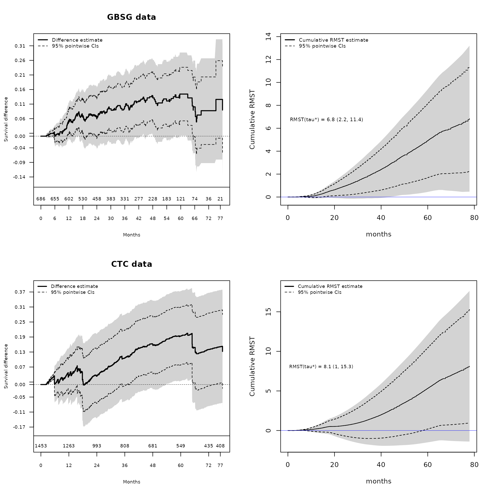

``` r

# kept for the reading at the horizon
band_CTC <- temp
rmst_CTC <- get_bands
```

At 60 months the weighted cross-trial survival difference is 0.19 (0.08,
0.31) and the cumulative RMST difference is 5.3 (0.2, 10.5) months
(estimates with pointwise 95% limits, weights treated as known).

## GBSG *subgroup* differences along with ITT simultaneous band:

Note that er=0 subgroup was identified as questionable benefit.

—- Subgroup Band Plot —-

``` r

par(mfrow=c(1,1))
sg_labs <- c("er == 0","er > 0", "meno == 0", "meno ==1")
sg_cols <- c("blue", "brown", "green", "turquoise")

# Randomly sample colors from the built-in palette
# n_sg <- length(sg_labs)
# set.seed(123) # for reproducibility
# sg_cols <- sample(colors(), n_sg)

  temp <- plotKM.band_subgroups(
    df=df_gbsg,
    sg_labels = sg_labs,
    sg_colors = sg_cols,
    xlabel="Months", ylabel="Survival difference",
    yseq_length=5, cex_Yaxis=0.7, risk_cex=0.7,
    tau_add=42, by.risk=6, risk_delta=0.05, risk.pad=0.03, draws.band = 1000,
    tte.name = tte.name, treat.name = treat.name, event.name = event.name 
  )
  legend("topleft", c("ITT", sg_labs),
         lwd=2, col=c("black", sg_cols), bty="n", cex=0.75)
  title(main="ITT and subgroups")
```

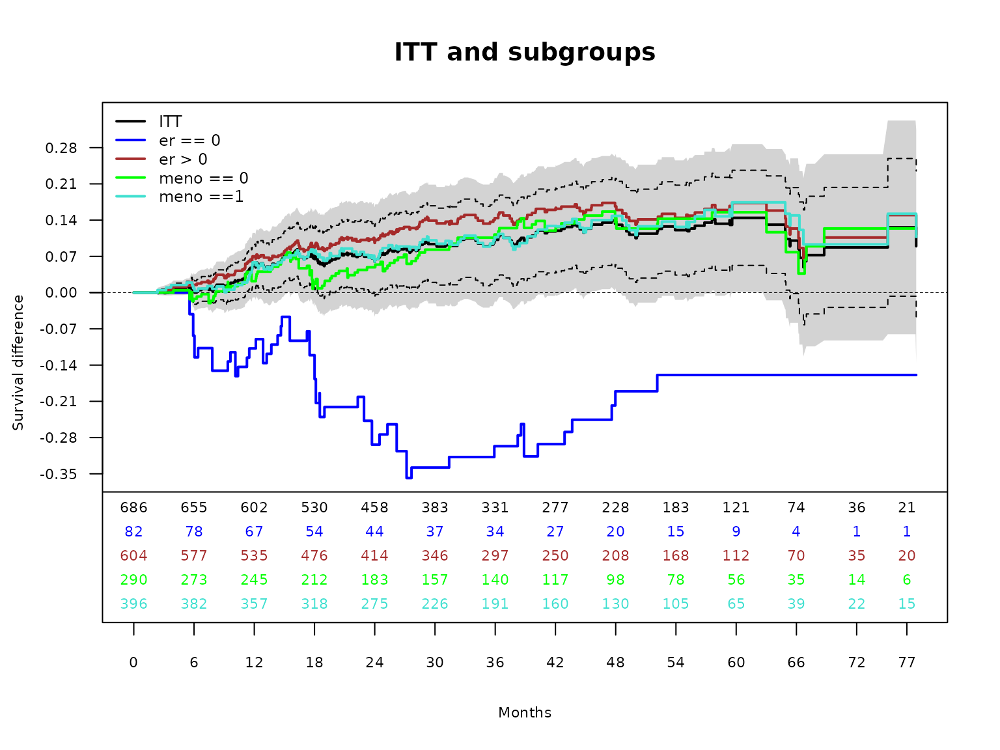

### Look at GBSG er\>0 subgroup population

—- Simultaneous CI bands —-

``` r

par(mfrow=c(1,2))
  temp <- plotKM.band_subgroups(
    df = subset(df_gbsg, er > 0),
    xlabel="Months", ylabel="Survival difference",
    yseq_length=5, cex_Yaxis=0.7, risk_cex=0.7,
    by.risk=6, risk_delta=0.075, risk.pad=0.03,
    tte.name = tte.name, treat.name = treat.name, event.name = event.name, draws.band = 1000, show_resamples = TRUE
  )
  legend("topleft", c("Difference estimate", "95% pointwise CIs"),
         lwd=c(2,1), col=c("black"), lty=c(1,2), bty="n", cex=0.75)
  title(main="Estrogen receptor positive (er>0) sub-population")
```

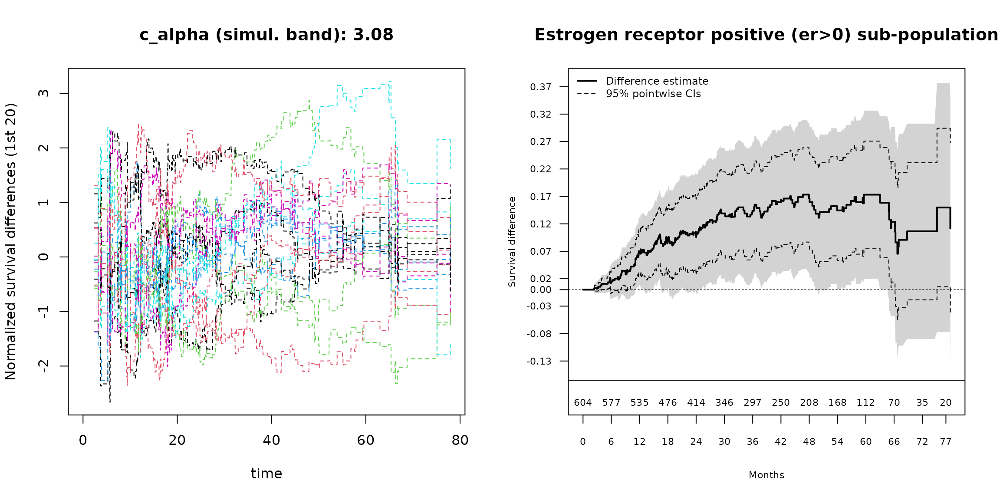

## Weighted Cox Analysis of Rotterdam data with time-dependent, and subject-specific \[ps weighting\] weighting

The FH(0,0) analysis (the Cox model with propensity-score weights) is
shown with the weights treated as estimated, with the asymptotic
interval, and with the weights treated as known, with the resampling
interval. The analyses with time-dependent weights (FH(0,1), FH_exp2,
MB(12), zero_one(6)) treat the propensity-score weights as known and
show the resampling interval (1000 draws). The table needs the
data.table and gt packages.

``` r

library(data.table)
library(gt)

# Restricted Rotterdam population, propensity-score weighted:
#   dfcount_rotterdam_wtd    weights treated as estimated (weight_variance = "estimated")
#   dfcount_rotterdam_known  weights treated as known (the default)
# cox_rhogamma() takes the option from the df_counting() result it is given.
#
# Note: with subject weights (here propensity-score weights) that are not all equal, the asymptotic
# SE of the log hazard ratio is the score-residual (robust) SE, and the resampling SE (draws > 0) is
# built from the same per-subject score contributions, so the two estimate the same quantity.
# hr_ci_asy is centred at the estimate; hr_ci_star is centred at the de-biased estimate and uses
# the resampling SE.

cox_row <- function(analysis, dfcount, interval = c("asymptotic", "resampling"), ...) {
  interval <- match.arg(interval)
  get_rg <- cox_rhogamma(dfcount = dfcount, ..., draws = if (interval == "resampling") 1000 else 0, verbose = FALSE)
  ci <- if (interval == "resampling") get_rg$hr_ci_star else get_rg$hr_ci_asy
  data.table(analysis = analysis, weights = get_rg$weight_variance, interval = interval,
             z = get_rg$z.score, hr = get_rg$hr_ci_asy$hr, lower = ci$lower, upper = ci$upper)
}

# compare with coxph() 
#cat("Comparison with coxph with weighting, coxph:", dfcount_rotterdam_wtd$cox_results$cox_text, "\n")

res_update <- rbind(
  cox_row("FH(0,0)", dfcount_rotterdam_wtd, "asymptotic", scheme = "fh", scheme_params = list(rho = 0, gamma = 0)),
  cox_row("FH(0,0)", dfcount_rotterdam_known, "resampling", scheme = "fh", scheme_params = list(rho = 0, gamma = 0)),
  cox_row("FH(0,1)", dfcount_rotterdam_known, "resampling", scheme = "fh", scheme_params = list(rho = 0, gamma = 1)),
  cox_row("FH_exp2", dfcount_rotterdam_known, "resampling", scheme = "fh_exp2"),
  cox_row("MB(12)", dfcount_rotterdam_known, "resampling", scheme = "MB", scheme_params = list(mb_tstar = 12)),
  cox_row("zero_one(6)", dfcount_rotterdam_known, "resampling", scheme = "custom_time", scheme_params = list(t.tau = 6, w0.tau = 0, w1.tau = 1))
)

res_update %>% gt()  %>% fmt_number(decimals = 3) 
```

| analysis    | weights   | interval   | z     | hr    | lower | upper |
|-------------|-----------|------------|-------|-------|-------|-------|
| FH(0,0)     | estimated | asymptotic | 4.869 | 0.665 | 0.564 | 0.784 |
| FH(0,0)     | known     | resampling | 4.449 | 0.665 | 0.560 | 0.797 |
| FH(0,1)     | known     | resampling | 2.578 | 0.763 | 0.623 | 0.941 |
| FH_exp2     | known     | resampling | 3.996 | 0.690 | 0.579 | 0.829 |
| MB(12)      | known     | resampling | 4.399 | 0.668 | 0.561 | 0.800 |
| zero_one(6) | known     | resampling | 4.117 | 0.675 | 0.562 | 0.816 |

## Some checks on results

The checks in this section treat the weights as known
(`weight_variance = "known"`, the default), as `survfit(weights = )`
does.

### Check weighted K-M SE’s with survfit

With weights that are not all equal, the standard error of a weighted
K-M curve is the robust standard error, which is also what
`survival::survfit(weights = )` reports. `check.seKM = TRUE` plots the
two against each other.

``` r

dfcount_rotterdam_known <- get_dfcounting(df=df_rotterdam, tte.name=tte.name, event.name=event.name, treat.name=treat.name, arms=arms, by.risk=24, 
                                  weight.name="sw.weights", check.seKM = TRUE, draws = 0)
```

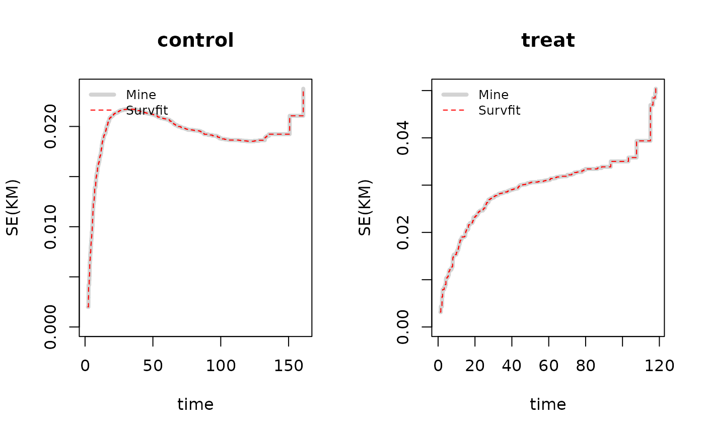

The weighted K-M standard errors agree with those of
[`survfit()`](https://rdrr.io/pkg/survival/man/survfit.html): the
largest absolute difference is 5^{-17} in the control arm and 5^{-17} in
the treated arm.

### Check SE’s calculated via resampling (draws = 5000)

Note that draws = 5000 does not take much time, but can be reduced to
around 500 for sufficient accuracy. The resampling-based pointwise
variance (`draws > 0`) is not available with
`weight_variance = "estimated"`, so this check stays on `"known"`.

``` r

dfcount_rotterdam_draws <- get_dfcounting(df=df_rotterdam, tte.name=tte.name, event.name=event.name, treat.name=treat.name, arms=arms, by.risk=24, 
                                  weight.name="sw.weights", check.seKM = TRUE, draws = 5000)
```

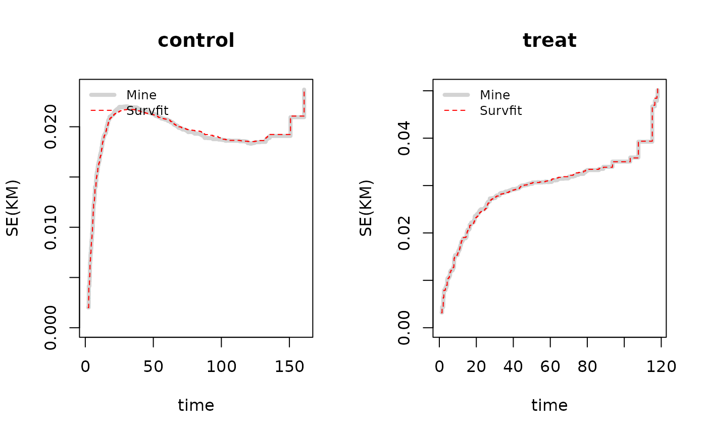

### Compare with the adjustedCurves package

The `adjustedCurves` call uses the same time and event variables as the
weightedsurv analysis (`tte` and `event`, defined in the data
preparation above) and the same propensity model. This comparison needs
the adjustedCurves and pammtools packages.

``` r

# Compare with adjustedCurves
library(adjustedCurves)
library(pammtools)
```

    ## 
    ## Attaching package: 'pammtools'

    ## The following object is masked from 'package:stats':
    ## 
    ##     filter

``` r

df_rotterdam$hormon2 <- with(df_rotterdam, factor(hormon, labels=c("No","Yes")))

ps_model <- glm(hormon2 ~ age+size+grade3+nodes+pgr+er, data = df_rotterdam, family="binomial")

iptw <- adjustedsurv(data=df_rotterdam, variable="hormon2", ev_time="tte", event = "event", method = "iptw_km", treatment_model = ps_model, conf_int = TRUE)
```

### Compare KM plots with adjustedCurves package

``` r

plot_weighted_km(dfcount=dfcount_rotterdam_known, conf.int = TRUE)
 title(main="Rotterdam weighted K-M curves")
```

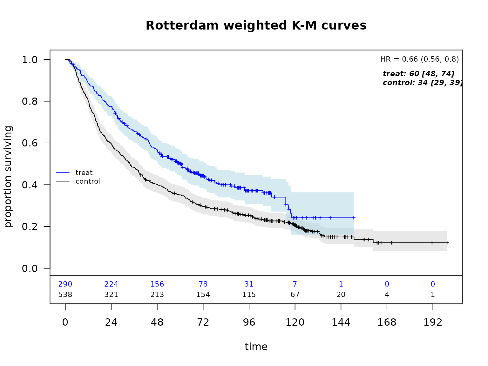

``` r

 plot(iptw, conf_int = TRUE, legend.title = "Hormonal therapy")
```

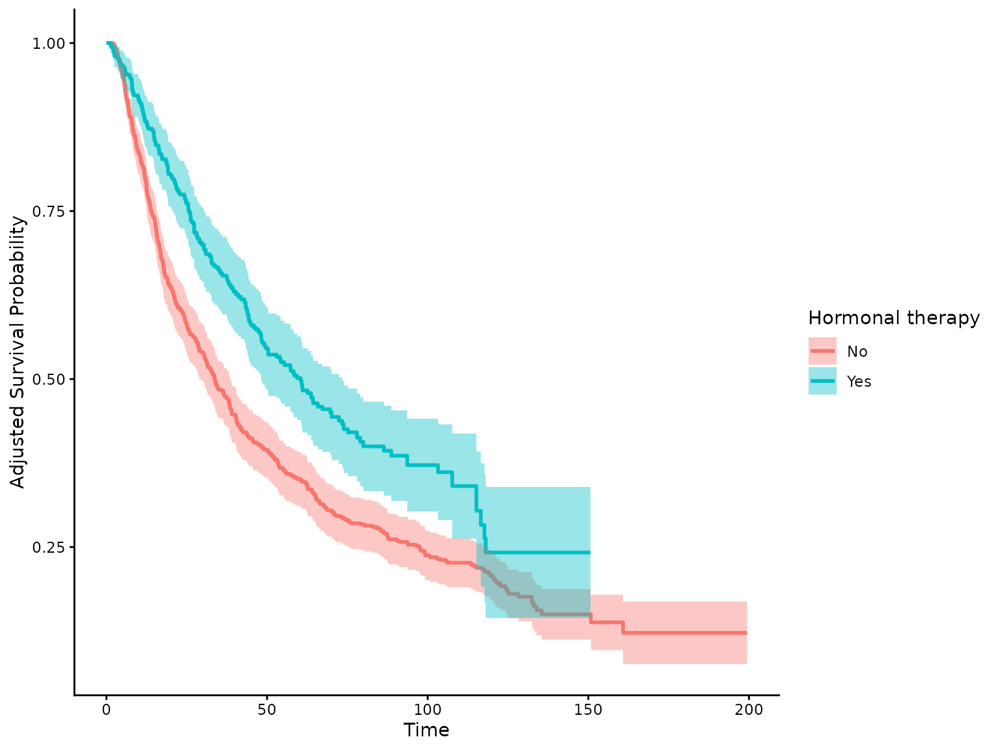

### Compare SE’s with adjustedCurves package

``` r

# Check SEs
par(mfrow=c(1,2))

df_mine <- dfcount_rotterdam_known

df_check <- subset(iptw$adj, group == "No")
yymax <- max(c(sqrt(df_mine$sig2_surv0[df_mine$idv0.check]), df_check$se))
toget <- df_mine$idv0.check
tt <- df_mine$at_points[toget]
yy <- sqrt(df_mine$sig2_surv0)[toget]
plot(tt,yy, type="s", lty=1, col="lightgrey", lwd=4, ylim=c(0,yymax), xlab="time", ylab="SEs")
with(df_check, lines(time, se, type="s", lty=2, lwd=1, col="red"))
title(main="Control SEs")


df_check <- subset(iptw$adj, group == "Yes")
yymax <- max(c(sqrt(df_mine$sig2_surv1[df_mine$idv1.check]), df_check$se))
toget <- df_mine$idv1.check
tt <- df_mine$at_points[toget]
yy <- sqrt(df_mine$sig2_surv1)[toget]
plot(tt,yy, type="s", lty=1, col="lightgrey", lwd=4, ylim=c(0,yymax), xlab="time", ylab="SEs")
with(df_check, lines(time, se, type="s", lty=2, lwd=1, col="red"))
title(main = "Treat SEs")
```

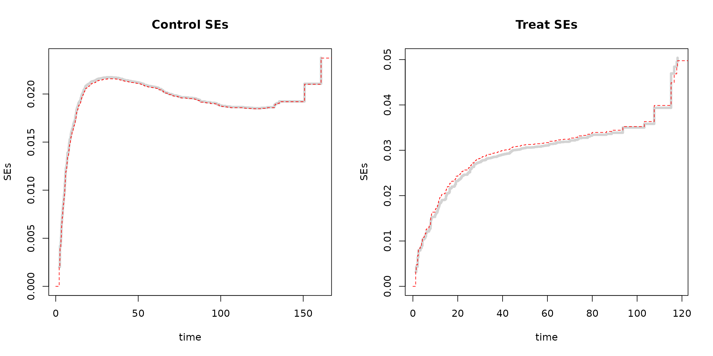

The weighted K-M curves of the two packages agree (largest absolute
difference 9^{-16}). The standard errors still differ: the ratio of the
weightedsurv standard error (grey) to the `iptw_km` standard error of
`adjustedCurves` (red) ranges from 1.00 to 1.06 in the control arm and
from 0.90 to 1.05 in the treated arm. The weighted K-M standard errors
of [`survfit()`](https://rdrr.io/pkg/survival/man/survfit.html) agree
with those of weightedsurv (see the check above).

### Check log-rank statistics

``` r

# dfcount_gbsg (un-weighted) contains logrank (chisq) stats from specified scheme (default is standard logrank rho=0 and gamma=0) from 3 sources:
# (1) lr^2 / sig2_lr: the weighted log-rank statistic and its variance (wlr_cumulative)
# (2) logrank_results$chisq: without subject weights (as here), survdiff, which only provides rho options
#     so gamma != 0 is not available; with subject weights that are not all equal it is instead the
#     robust score test of the weighted Cox model (coxph, robust = TRUE), see logrank_results$method
# (3) z.score^2: the standardized weighted log-rank statistic (Cox score-test perspective)
check_results(dfcount_gbsg)
```

    ## 
    ## Test Statistic Comparison:
    ## (These should be approximately equal)
    ## 
    ##    zlr_sq logrank_chisq  zCox_sq
    ##  8.564781      8.564781 8.564781
    ## 
    ## Relative difference: 8.711e-13%

``` r

# Check wlr_dhat_estimates which calculates from any scheme based on counting dataset 
# In addition, calculates dhat's at tzero as well as correlation with log-rank
temp <- wlr_dhat_estimates(dfcounting = dfcount_gbsg, scheme_params = list(rho = 0, gamma = 0), scheme = "fh", tzero = 12)
temp$z.score^2
```

    ## [1] 8.564781

2.  Stratified by grade, just for illustration

``` r

res <- df_counting(df=df_gbsg, tte.name=tte.name, event.name=event.name, treat.name=treat.name, arms=arms, strata.name="grade")
```

stratified

``` r

with(res,lr_stratified^2/sig2_lr_stratified)
```

    ## [1] 7.395797

``` r

# logrank_results: survdiff, stratified (un-weighted data; with subject weights that are not all equal
# this element is the stratified robust score test of the weighted Cox model)
res$logrank_results$chisq
```

    ## [1] 7.395797

``` r

 # Cox score stratified
with(res,z.score_stratified^2)
```

    ## [1] 7.395797

non-stratified (should be same as above results without stratification)

``` r

with(res,lr^2/sig2_lr)
```

    ## [1] 8.564781

``` r

with(res,z.score^2)
```

    ## [1] 8.564781

``` r

# Restore when done
par(oldpar)
```

Cole, Stephen R., and Miguel A. Hernán. 2004. “Adjusted Survival Curves
with Inverse Probability Weights.” *Computer Methods and Programs in
Biomedicine* 75 (1): 45–49.
<https://doi.org/10.1016/j.cmpb.2003.10.004>.

Leon, Larry. 2024. *Weightedsurv: Weighted Survival Analysis in R*.
[Https://github.com/larry-leon/weightedsurv](https://github.com/larry-leon/weightedsurv).

Royston, Patrick, and Douglas G. Altman. 2013. “External Validation of a
Cox Prognostic Model: Principles and Methods.” *BMC Medical Research
Methodology* 13: 33. <https://doi.org/10.1186/1471-2288-13-33>.

Schumacher, M, G Bastert, H Bojar, et al. 1994. “Randomized 2 x 2 Trial
Evaluating Hormonal Treatment and the Duration of Chemotherapy in
Node-Positive Breast Cancer Patients. German Breast Cancer Study Group.”
*Journal of Clinical Oncology* 12 (10): 2086–93.
<https://doi.org/10.1200/JCO.1994.12.10.2086>.

Therneau, Terry M. 2023. *A Package for Survival Analysis in r*.
<https://CRAN.R-project.org/package=survival>.

Uno, Hajime, Brian Claggett, Lu Tian, et al. 2014. “Moving Beyond the
Hazard Ratio in Quantifying the Between-Group Difference in Survival
Analysis.” *Journal of Clinical Oncology* 32 (22): 2380–85.
<https://doi.org/10.1200/JCO.2014.55.2208>.
